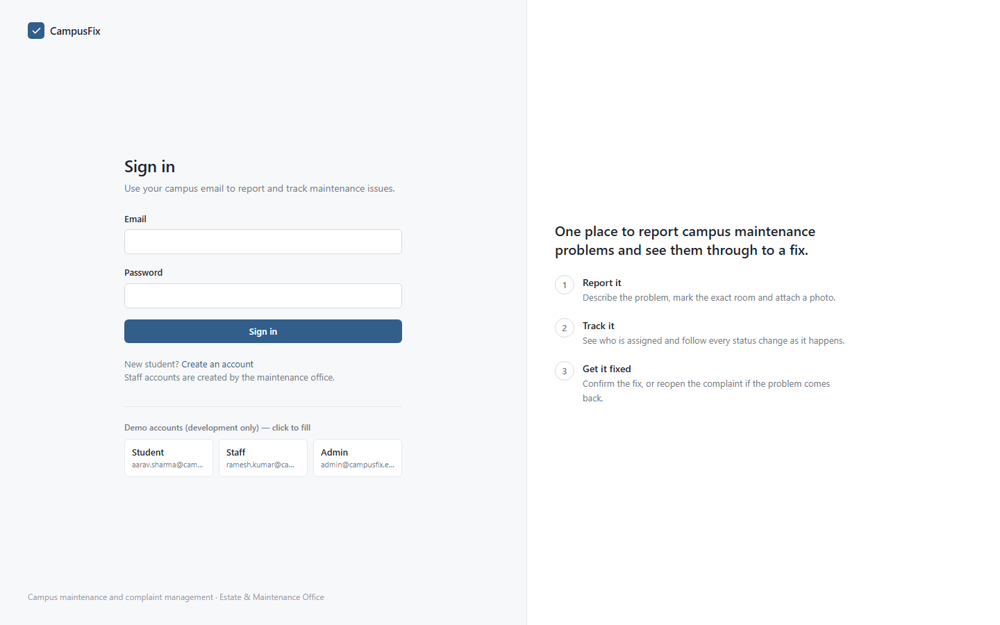
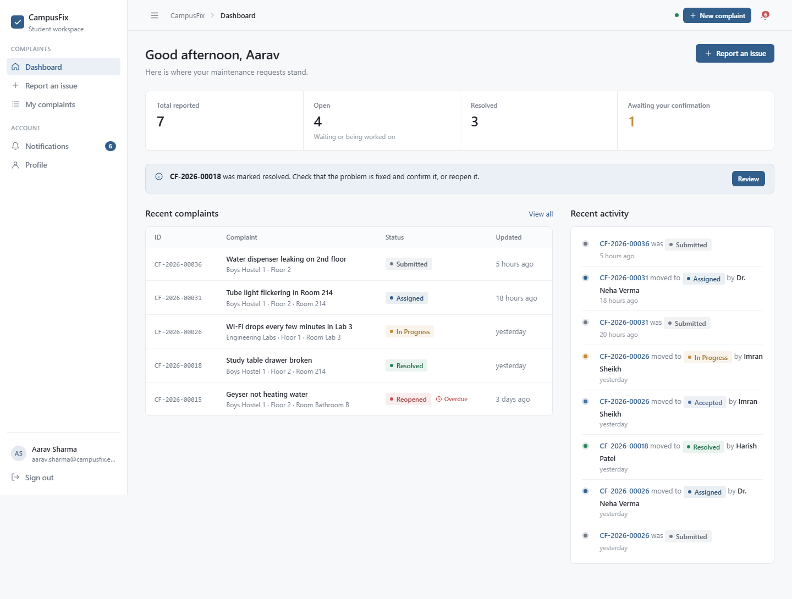
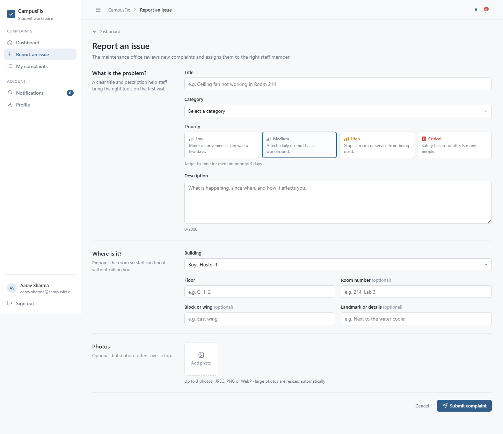
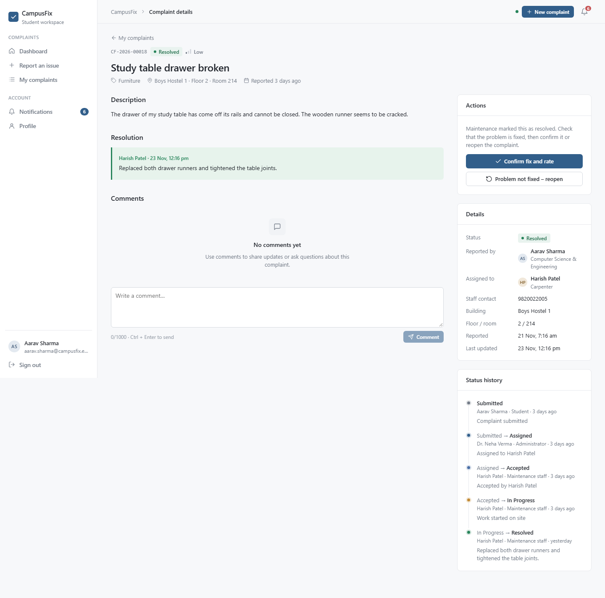
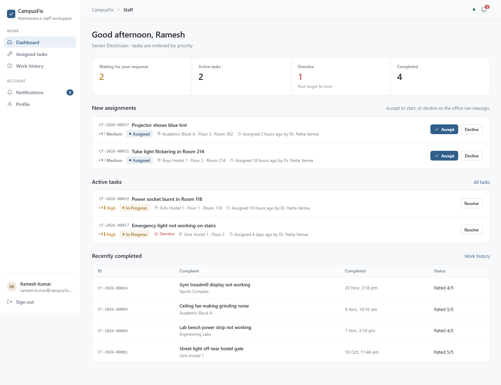
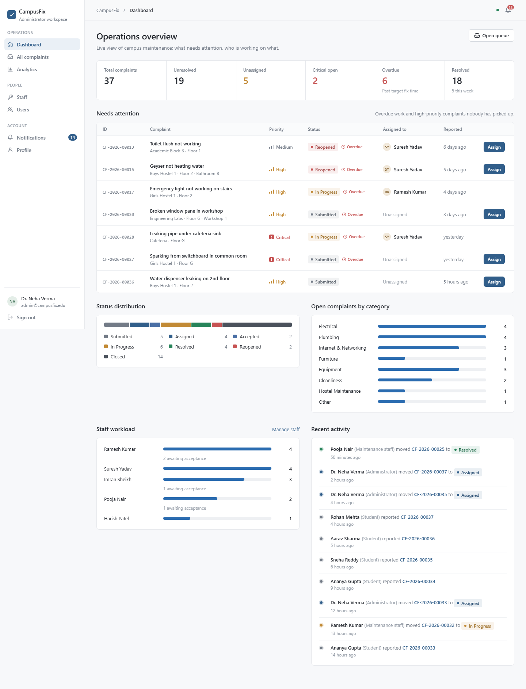
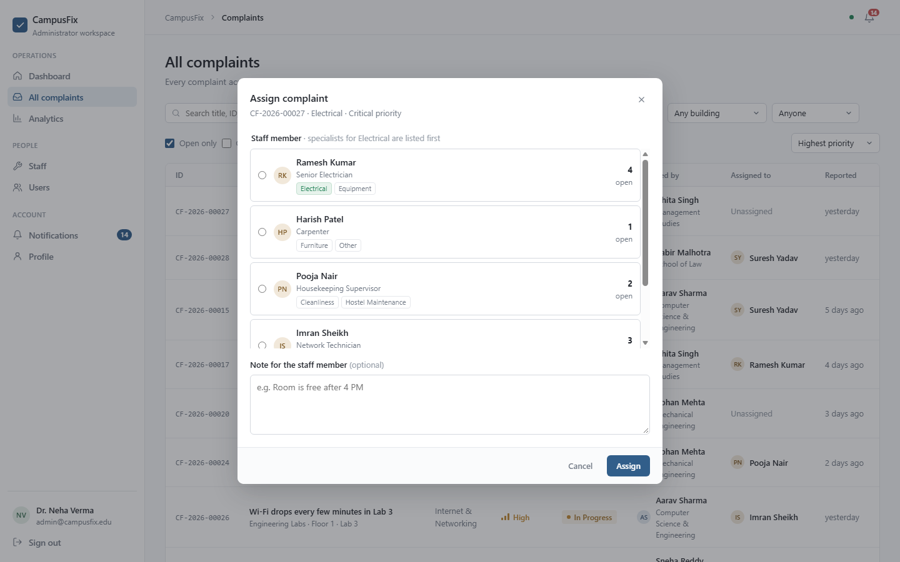
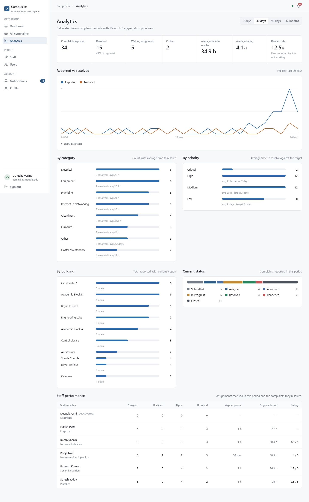
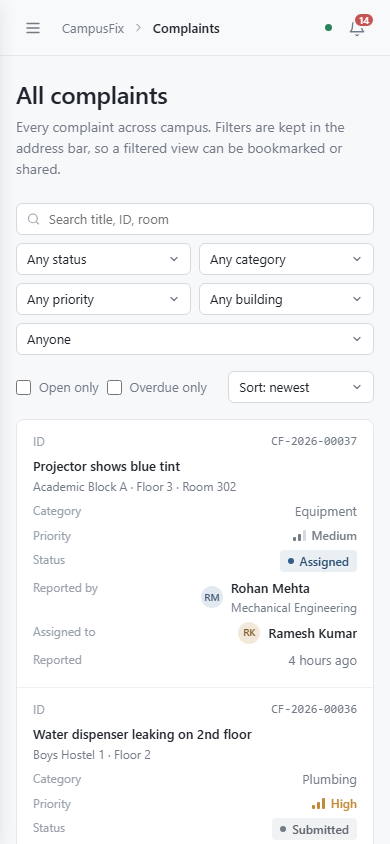

# CampusFix

**Report it. Track it. Get it fixed.**

CampusFix is a full-stack campus maintenance and complaint management platform. Students report infrastructure problems, the maintenance office assigns them to the right staff member, staff update progress on site, and everyone sees each change in real time.

Built with React, Node.js, Express, MongoDB (Mongoose), JWT authentication, Node's `EventEmitter` and Socket.IO.

---

## Table of contents

1. [Project description](#1-project-description)
2. [Problem statement](#2-problem-statement)
3. [Proposed solution](#3-proposed-solution)
4. [Features](#4-features)
5. [Technology stack](#5-technology-stack)
6. [Application architecture](#6-application-architecture)
7. [Project folder structure](#7-project-folder-structure)
8. [Actors and user roles](#8-actors-and-user-roles)
9. [Database collections and relationships](#9-database-collections-and-relationships)
10. [API documentation](#10-api-documentation)
11. [Authentication and authorization](#11-authentication-and-authorization)
12. [Real-time communication](#12-real-time-communication)
13. [Event-driven architecture](#13-event-driven-architecture)
14. [Prerequisites](#14-prerequisites)
15. [Installation instructions](#15-installation-instructions)
16. [Environment variables](#16-environment-variables)
17. [Database configuration](#17-database-configuration)
18. [Running the application](#18-running-the-application)
19. [Application URLs](#19-application-urls)
20. [Demo accounts](#20-demo-accounts)
21. [Screenshots](#21-screenshots)
22. [Testing](#22-testing)
23. [Future scope](#23-future-scope)
24. [Contributors](#24-contributors)

---

## 1. Project description

CampusFix connects three groups through one system:

- **Students** report problems such as a broken fan, a leaking tap or no Wi-Fi, pinpoint the building, floor and room, attach photos, and follow the complaint until it is fixed.
- **Maintenance staff** receive assignments, accept or decline them, record progress and resolution notes, and keep a work history.
- **Administrators** (the maintenance office) see every complaint, assign and reassign work, manage accounts, watch overdue and critical issues, and analyse performance.

Each complaint follows a validated lifecycle with a full audit trail. Every change produces notifications that reach the right people instantly over WebSockets.

## 2. Problem statement

On most campuses, maintenance requests travel through informal channels: a visit to the administration office, a phone call to a known electrician, or a message in a hostel group. This causes recurring problems:

- Requests are lost or duplicated, and nobody can tell whether anyone is working on a problem.
- Students have to follow up in person repeatedly.
- The maintenance office has no single view of open work, workload per staff member or overdue issues.
- There is no record of who fixed what, how long it took, or whether the fix held.

## 3. Proposed solution

CampusFix replaces these channels with a single workflow:

1. A student submits a structured complaint (category, priority, exact location, photos).
2. The maintenance office sees it immediately and assigns it to a staff member. Specialists for the category and their current workload are shown first.
3. The staff member accepts the assignment (or declines it with a reason), starts work and resolves it with notes.
4. The student confirms the fix with a rating, which closes the complaint, or reopens it if the problem persists.
5. Every transition is validated by the server, recorded in a status history, and pushed as a notification to the people involved.
6. Administrators track performance with analytics calculated from real records using MongoDB aggregation pipelines.

## 4. Features

### Student
- Register, sign in and sign out; the session is restored automatically through a secure refresh cookie.
- Dashboard with totals, recent complaints, a status activity feed and a prompt when a fix needs confirmation.
- Report an issue: title, category, priority (with a target fix time), description, building, block, floor, room, landmark, and up to 3 photos (resized in the browser when large).
- My complaints: search, filter by status and category, and pagination.
- Complaint details: description, photos, resolution notes, assigned staff and contact, status history timeline, and live comments.
- Confirm the fix with a 1–5 rating (closes the complaint) or reopen it with a reason.
- Real-time notifications (toast, bell badge, notifications page) and an editable profile.

### Maintenance staff
- Dashboard: new assignments with one-click accept or decline, active tasks ordered by priority, overdue count and recently completed work.
- Assigned tasks with tabs (current, waiting for response, accepted, completed).
- Task details: start work with a progress note, resolve with resolution notes, and comment with the student.
- Work history with outcome (completed, declined, reassigned), time taken, ratings, average resolution time and average rating.
- Real-time assignment notifications.

### Administrator
- Operations dashboard: totals, unresolved, unassigned, critical, overdue and resolved-this-week counts; a "needs attention" queue with quick assign; status distribution; open complaints by category; staff workload; and a recent activity feed.
- All complaints: search and filter by status, category, priority, building and assignee, plus "open only" and "overdue only" toggles and sorting. Filters live in the URL, so views can be bookmarked or shared.
- Assign or reassign through a staff picker that shows specialisations and live workload; close invalid, duplicate or inspected complaints.
- Complaint details with the full assignment trail.
- Staff management: create staff accounts, edit details and specialisations, and activate or deactivate accounts. Deactivating someone with open work is blocked until that work is reassigned.
- User management: browse students, staff and admins, search, see complaint counts, and activate or deactivate accounts.
- Analytics: KPIs, a reported-vs-resolved trend, breakdowns by category, priority (against target time), building and status, and a staff performance table. Ranges are 7, 30 or 90 days, or 12 months.

### Platform
- Validated status lifecycle with an append-only status history.
- Priority-based target fix times: Critical 24 h, High 48 h, Medium 72 h, Low 120 h. Open complaints past their target are flagged as overdue.
- Consistent JSON responses and status codes, centralised error handling, and request logging.
- Responsive layout from desktop to mobile: tables become stacked cards and the sidebar becomes a drawer.
- Accessible forms (labels, error messages linked to their fields), focus-trapped modals and keyboard support.

## 5. Technology stack

| Layer | Technology |
|---|---|
| Frontend | HTML5, CSS3 (plain CSS, no framework), JavaScript, React 19 (functional components and hooks), React Router DOM 7, Fetch API, socket.io-client |
| Build tool | Vite (development server and production build for React) |
| Backend | Node.js, Express 5, core modules (`http`, `events`, `fs`, `path`, `crypto`) |
| Database | MongoDB, Mongoose 9 |
| Security | bcrypt, JSON Web Tokens (access and refresh), HttpOnly cookies, dotenv |
| Real time | Node.js `EventEmitter`, Socket.IO |
| Testing | Node's built-in test runner (`node:test`), Postman |
| Tooling | npm, Git, GitHub |

**Choices made to stay inside the syllabus:**

- **Image uploads** are sent as base64 data URLs in the JSON body. They are decoded, checked by their file signature and written to disk with the core `fs`, `crypto` and `path` modules, so no upload library is needed.
- **Cookies** are read by a small custom middleware instead of `cookie-parser`.
- **Validation** uses a custom declarative middleware instead of a validation library.
- **CORS** is not needed: in development the React dev server proxies `/api`, `/uploads` and `/socket.io` to Express, so the browser sees a single origin.
- **Icons** are inline SVG and **charts** are plain CSS/SVG, so no UI, icon or chart libraries are used.

## 6. Application architecture

```
┌────────────────────────────── Browser (React) ──────────────────────────────┐
│  Pages (student / staff / admin)  →  services/*.js  →  api.js (fetch)        │
│  AuthContext (in-memory access token)    SocketContext (socket.io-client)    │
└──────────────┬───────────────────────────────────────────┬──────────────────┘
               │ REST  /api/*  (Bearer access token)        │ WebSocket /socket.io
               │ refresh: HttpOnly cookie on /api/auth      │ (token in handshake)
┌──────────────▼───────────────────────────────────────────▼──────────────────┐
│ Express app                                                                  │
│   requestLogger → json parser → cookieParser → routes → notFound → errorHandler
│   route:  authenticate → authorize(role) → validate(schema) → controller     │
│                                                       │                      │
│   controllers (HTTP only) ─────────────────────────► services (business rules)
│                                                       │        │             │
│                                    Mongoose models ◄──┘        │ emit        │
│                                                                ▼             │
│                     events/complaintEvents (EventEmitter) ──► listeners      │
│                                                     │              │         │
│                              Notification documents ┘              ▼         │
│                                                     sockets/ (rooms: user:<id>,
│                                                     role:admin, complaint:<id>)
└──────────────────────────────────────┬───────────────────────────────────────┘
                                       ▼
                                   MongoDB
```

- **MVC with a service layer.** Routes declare the middleware chain, controllers translate HTTP to service calls, services hold business rules (ownership, transitions, assignments), and models define schemas, validation and indexes.
- **Events decouple side effects.** Services emit events after saving; listeners create notifications and push socket updates. Controllers never talk to sockets.
- **The server is the source of truth for permissions.** The React route guards only hide screens; every rule is enforced in middleware and services.

## 7. Project folder structure

```
webdev3_capstone/
├── backend/
│   ├── config/            env.js (validated environment), db.js (Mongoose connection)
│   ├── controllers/       auth, user, complaint, comment, assignment, admin, analytics, notification
│   ├── events/
│   │   ├── complaintEvents.js        EventEmitter bus + event names
│   │   └── listeners/                notificationListeners, realtimeListeners, index
│   ├── middleware/        auth (authenticate/authorize), validate, errorHandler, requestLogger, cookieParser
│   ├── models/            User, Complaint, Assignment, Comment, Notification, StatusHistory, Counter
│   ├── routes/            auth, user, complaint, comment, assignment (staff), admin, analytics, notification
│   ├── scripts/seed.js    demo data
│   ├── services/          auth, token, complaint, complaintAccess, status, assignment, comment,
│   │                      notification, user, analytics
│   ├── sockets/index.js   Socket.IO server, auth middleware, rooms, emit helpers
│   ├── tests/             integration tests (node:test)
│   ├── uploads/           complaint photos (git-ignored)
│   ├── utils/             ApiError, apiResponse, constants, imageStorage, pagination
│   ├── validators/        request schemas per resource
│   ├── app.js             Express app (middleware + routes)
│   ├── server.js          HTTP server, Socket.IO, listeners, DB connection
│   └── package.json
├── frontend/
│   ├── public/            favicon
│   ├── src/
│   │   ├── components/    Sidebar, Topbar, Button, FormControls, Modal, Badges, ComplaintTable,
│   │   │                  ComplaintDetailView, ComplaintActions, CommentThread, StatusTimeline,
│   │   │                  NotificationPanel, Charts, ImagePicker, States, ProtectedRoute, ...
│   │   ├── context/       AuthContext, SocketContext, ToastContext
│   │   ├── hooks/         useAsync, useSocketEvent, useDebouncedValue, useDocumentTitle
│   │   ├── layouts/       AppLayout, AuthLayout
│   │   ├── pages/
│   │   │   ├── auth/      LoginPage, RegisterPage
│   │   │   ├── student/   StudentDashboard, CreateComplaint, MyComplaints, StudentComplaintDetail
│   │   │   ├── staff/     StaffDashboard, AssignedTasks, TaskDetail, WorkHistory
│   │   │   ├── admin/     AdminDashboard, AllComplaints, AdminComplaintDetail, StaffManagement,
│   │   │   │              UserManagement, Analytics
│   │   │   └── shared/    NotificationsPage, ProfilePage, NotFoundPage
│   │   ├── services/      api.js (fetch + refresh), socket.js, per-resource services
│   │   ├── styles/        tokens.css, base.css, layout.css, components.css, pages.css
│   │   ├── utils/         format.js
│   │   ├── constants.js
│   │   ├── App.jsx
│   │   └── main.jsx
│   ├── index.html
│   ├── vite.config.js     dev proxy to the backend
│   └── package.json
├── docs/
│   ├── CampusFix.postman_collection.json
│   └── screenshots/
├── .env.example
├── .gitignore
└── README.md
```

## 8. Actors and user roles

| Capability | Student | Staff | Admin |
|---|:-:|:-:|:-:|
| Register publicly | ✓ | – | – |
| Create complaints | ✓ | – | – |
| View complaints | own only | assigned (current or past) | all |
| Comment on complaints | own | assigned | all |
| Reopen / confirm and rate | own, when Resolved | – | – |
| Accept / decline assignments | – | own | – |
| Set In Progress / Resolved | – | own assignments | – |
| Assign / reassign / close | – | – | ✓ |
| Create staff, activate/deactivate users | – | – | ✓ (not other admins) |
| Analytics and staff performance | – | – | ✓ |
| Edit own profile, change password | ✓ | ✓ | ✓ |

Nobody can change their own role, and public registration always creates a student. Unknown fields such as `role` or `isActive` are stripped from request bodies by the validation middleware.

### Complaint lifecycle

```
Submitted ──assign──► Assigned ──accept──► Accepted ──start──► In Progress ──resolve──► Resolved ──confirm──► Closed
    ▲                    │  ▲                  │                    │                     │
    └────── decline ─────┘  └──── reassign ────┴────────────────────┘                     ├──reopen──► Reopened
                                                                                          │              │
Submitted / Reopened / Resolved ──admin close──► Closed            Reopened ──start (same staff) / reassign──┘
```

| From | Allowed next status | Who |
|---|---|---|
| Submitted | Assigned / Closed | Admin |
| Assigned | Accepted / Submitted (declined) | Assigned staff |
| Assigned, Accepted, In Progress, Reopened | Assigned (reassign) | Admin |
| Accepted, Reopened | In Progress | Assigned staff |
| In Progress | Resolved (resolution notes required) | Assigned staff |
| Resolved | Closed (feedback) / Reopened (reason) | Reporting student |
| Resolved, Reopened | Closed | Admin |
| Closed | — | — |

The map lives in `backend/utils/constants.js` (`STATUS_TRANSITIONS`) and is checked by `statusService.changeStatus` before every update. The role rules are enforced in the services.

## 9. Database collections and relationships

```
            ┌───────────┐ reportedBy          ┌─────────────┐
            │   users   │◄────────────────────│ complaints  │
            │           │◄────────────────────│             │
            └───────────┘ assignedTo          └─────────────┘
              ▲  ▲  ▲  ▲                          ▲  ▲  ▲  ▲
   assignedTo │  │  │  └ recipient   complaint ───┘  │  │  └── relatedComplaint
   assignedBy │  │  └ author                         │  │
   changedBy  │  │                                   │  │
        ┌─────┴──┴───┐ ┌──────────┐ ┌──────────────┐ │  │ ┌───────────────┐
        │assignments │ │ comments │ │statushistories│◄┘  └─│ notifications │
        └────────────┘ └──────────┘ └──────────────┘       └───────────────┘
```

| Collection | Key fields | Relationships | Indexes |
|---|---|---|---|
| **users** | name, email (unique, lowercase), password (bcrypt, `select:false`), role, department, phone, studentId, hostel, designation, specializations[], bio, isActive, lastLoginAt, refreshSessions[] (hashed, `select:false`), timestamps | — | email (unique), role + isActive |
| **complaints** | complaintCode (CF-YYYY-NNNNN, unique), title, description, category, priority, status, building, block, floor, roomNumber, location, images[], resolutionNotes, resolvedAt, closedAt, reopenCount, feedback {rating, comment}, timestamps | reportedBy → users, assignedTo → users | reportedBy + createdAt, assignedTo + status, status + priority + createdAt, category, building, text (title, description, location) |
| **assignments** | assignmentStatus (pending, accepted, rejected, completed, reassigned), assignedAt, acceptedAt, rejectedAt, completedAt, remarks, responseNote | complaint → complaints, assignedBy → users, assignedTo → users | assignedTo + assignmentStatus + assignedAt, complaint + assignedAt |
| **comments** | message, createdAt | complaint → complaints, author → users | complaint + createdAt |
| **notifications** | title, message, type, isRead, createdAt | recipient → users, relatedComplaint → complaints | recipient + isRead + createdAt |
| **statushistories** | previousStatus (null on creation), newStatus, remarks, createdAt | complaint → complaints, changedBy → users | complaint + createdAt |
| **counters** | `_id` (sequence name), seq | — | — (used to generate complaint codes atomically) |

Design notes:
- `assignedTo` on the complaint is the current owner; the `assignments` collection keeps the complete hand-off trail, including declined and reassigned assignments.
- Status history is append-only and never duplicated on the complaint.
- `populate` is used for details (reporter, assignee, history authors); aggregation pipelines with `$lookup`, `$facet`, `$group` and `$dateToString` power listings and analytics.

## 10. API documentation

**Base URL:** `http://localhost:5100`. Every request and response body is JSON.

**Response format**

```json
{ "success": true, "message": "Complaint submitted successfully", "data": { }, "meta": { "page": 1, "limit": 20, "total": 37, "totalPages": 2 } }
```

`meta` is present on paginated lists. Errors look like this:

```json
{ "success": false, "message": "Title must be at least 5 characters", "errors": [{ "field": "title", "message": "Title must be at least 5 characters" }] }
```

`errors` is present on validation failures. Auth errors include a `code`, such as `TOKEN_EXPIRED`, `TOKEN_MISSING` or `REFRESH_REUSED`.

**Common status codes:** `200` OK · `201` Created · `400` validation error / malformed JSON · `401` not signed in or token invalid or expired · `403` wrong role, not your resource, or deactivated account · `404` not found · `409` conflict (duplicate email, already assigned, feedback already given) · `413` body too large · `422` invalid status transition · `500` server error.

**Authentication:** send `Authorization: Bearer <accessToken>` on protected endpoints. The refresh token travels only as the `cf_refresh` HttpOnly cookie.

All requests below are also in [`docs/CampusFix.postman_collection.json`](docs/CampusFix.postman_collection.json). Import it into Postman, run `npm run seed`, then run the three *Login* requests; tokens and ids are captured into collection variables automatically.

---

### 10.1 Public and authentication

#### `GET /api/health`
Health check. **Auth:** none.
```json
{ "success": true, "message": "CampusFix API is running", "data": { "uptimeSeconds": 42, "database": "connected" } }
```

#### `POST /api/auth/register`
Creates a **student** account and signs it in. **Auth:** none. Any `role` or `isActive` field is ignored.

| Body field | Rules |
|---|---|
| name | required, 2–80 chars |
| email | required, valid email, unique |
| password | required, 8–72 chars, at least one letter and one number |
| department | required |
| studentId | required, ≤ 30 chars |
| phone | optional, 7–15 digits |
| hostel | optional |

```json
{ "name": "Riya Kapoor", "email": "riya.kapoor@campus.edu", "password": "Campus123",
  "department": "Computer Science & Engineering", "studentId": "2024CSE017", "hostel": "Girls Hostel 1" }
```
**201**: sets the `cf_refresh` cookie.
```json
{ "success": true, "message": "Account created successfully",
  "data": { "user": { "_id": "665f…", "name": "Riya Kapoor", "email": "riya.kapoor@campus.edu", "role": "student", "isActive": true, "…": "…" },
            "accessToken": "eyJhbGciOi…" } }
```
**Errors:** `400` validation · `409` email already exists.

#### `POST /api/auth/login`
**Auth:** none. **Body:** `{ "email": "admin@campusfix.edu", "password": "Admin@123" }`

**200**: `{ "data": { "user": { … }, "accessToken": "…" } }` and sets the `cf_refresh` cookie.
**Errors:** `400` missing fields · `401` `Invalid email or password` (same message for an unknown email) · `403` account deactivated.

#### `POST /api/auth/refresh`
Exchanges the `cf_refresh` cookie for a new access token and **rotates** the refresh token. **Auth:** cookie only, no body.

**200**: `{ "data": { "user": { … }, "accessToken": "…" } }`
**Errors:** `401` `REFRESH_MISSING` / `REFRESH_INVALID` / `REFRESH_REUSED` (a token was replayed after rotation, so all sessions are revoked) · `403` deactivated.

#### `POST /api/auth/logout`
Revokes the current refresh token and clears the cookie. **Auth:** cookie. **200**: `{ "success": true, "message": "Signed out successfully", "data": null }`

#### `GET /api/auth/me`
**Auth:** any role. **200**: `{ "data": { "user": { … } } }` · **Errors:** `401`, `403`.

---

### 10.2 Student endpoints (role: `student`)

#### `POST /api/complaints`
Create a complaint. JSON body limit is 8 MB for this route only.

| Body field | Rules |
|---|---|
| title | required, 5–120 |
| description | required, 15–2000 |
| category | required: Electrical, Plumbing, Internet & Networking, Furniture, Equipment, Cleanliness, Hostel Maintenance, Other |
| priority | required: Low, Medium, High, Critical |
| building | required, one of the campus buildings (see `BUILDINGS` in `utils/constants.js`) |
| floor | required, ≤ 20 |
| roomNumber, block, location | optional |
| images | optional, ≤ 3 items `{ "name": "fan.jpg", "dataUrl": "data:image/jpeg;base64,…" }`, JPEG/PNG/WebP, ≤ 2 MB each, checked by file signature |

```json
{ "title": "Fan not working in Room 214", "description": "The ceiling fan does not start at any speed since this morning.",
  "category": "Electrical", "priority": "Medium", "building": "Boys Hostel 1", "floor": "2", "roomNumber": "214", "images": [] }
```
**201**
```json
{ "success": true, "message": "Complaint submitted successfully",
  "data": { "complaint": { "_id": "6660…", "complaintCode": "CF-2026-00038", "status": "Submitted", "priority": "Medium",
            "reportedBy": { "_id": "…", "name": "Aarav Sharma", "…": "…" }, "assignedTo": null, "images": [], "createdAt": "…" } } }
```
**Errors:** `400` validation or invalid image · `401` · `403` non-student · `413` body too large.
**Side effects:** status history entry, `complaintCreated` event, notification and socket push to all admins.

#### `GET /api/complaints/my-complaints`
**Query:** `page`, `limit` (≤ 100), `status`, `category`, `search` (title or code).
**200**: `{ "data": { "complaints": [ { …, "isOverdue": false } ] }, "meta": { "page": 1, "limit": 15, "total": 7, "totalPages": 1 } }`

#### `GET /api/complaints/my-summary`
Dashboard data. **200**:
```json
{ "data": { "totals": { "total": 7, "open": 4, "resolved": 3, "awaitingConfirmation": 1 },
            "byStatus": { "Submitted": 1, "Resolved": 1, "…": 0 }, "recent": [ … 5 complaints ], "activity": [ … 8 status changes ] } }
```

#### `POST /api/complaints/:id/reopen`
Only the reporter, only while **Resolved**. **Body:** `{ "reason": "Water turns cold again after ten minutes." }` (10–500 chars)
**200**: `{ "data": { "complaint": { "status": "Reopened", "reopenCount": 1, … } } }`
**Errors:** `400` · `403` not the reporter · `404` · `422` not Resolved.

#### `POST /api/complaints/:id/feedback`
Confirms the fix and closes the complaint. If an admin already closed a resolved complaint, the rating is still accepted.
**Body:** `{ "rating": 4, "comment": "Works now, thanks" }` (rating is an integer from 1 to 5)
**200**: `{ "data": { "complaint": { "status": "Closed", "feedback": { "rating": 4, "comment": "Works now, thanks", "submittedAt": "…" }, … } } }`
**Errors:** `400` · `403` · `409` feedback already given · `422` not yet resolved.

---

### 10.3 Shared complaint endpoints (any role, access-checked)

Students may access only their own complaints, staff only complaints currently or previously assigned to them, and admins all complaints. Otherwise the API returns `403`.

#### `GET /api/complaints/:id`
**200**
```json
{ "data": {
    "complaint": { "_id": "…", "complaintCode": "CF-2026-00018", "status": "Resolved", "isOverdue": false,
                   "reportedBy": { "name": "Aarav Sharma", "department": "…" }, "assignedTo": { "name": "Harish Patel", "designation": "Carpenter", "phone": "…" },
                   "resolutionNotes": "Replaced both drawer runners…", "…": "…" },
    "history": [ { "previousStatus": null, "newStatus": "Submitted", "changedBy": { "name": "Aarav Sharma", "role": "student" }, "remarks": "Complaint submitted", "createdAt": "…" } ],
    "assignments": [ { "assignmentStatus": "completed", "assignedTo": { "name": "Harish Patel" }, "assignedBy": { "name": "Dr. Neha Verma" }, "…": "…" } ] } }
```
`assignments` is empty for students and contains only the caller's own assignments for staff.
**Errors:** `400` invalid id · `403` · `404`.

#### `GET /api/complaints/:id/history`
**200**: `{ "data": { "history": [ … ] } }`, oldest first.

#### `GET /api/complaints/:id/comments`
**200**: `{ "data": { "comments": [ { "_id": "…", "message": "…", "author": { "name": "Ravi", "role": "staff" }, "createdAt": "…" } ] } }`

#### `POST /api/complaints/:id/comments`
**Body:** `{ "message": "Please check and confirm." }` (1–1000 chars)
**201**: `{ "data": { "comment": { … } } }`. The comment is also broadcast as `comment:new` to the complaint room and notifies the other participant.
**Errors:** `400` · `403` · `404` · `422` complaint is closed.

---

### 10.4 Staff endpoints (role: `staff`)

#### `GET /api/staff/dashboard`
**200**
```json
{ "data": { "totals": { "pending": 2, "active": 2, "completed": 4, "overdue": 1 },
            "pending": [ assignment… ], "active": [ assignment… ], "recentCompleted": [ assignment… ] } }
```
Each assignment includes a populated `complaint` (with `isOverdue`) and `assignedBy`.

#### `GET /api/staff/assignments`
**Query:** `view` = `current` (default: pending and accepted) | `pending` | `active` | `completed` | `history`, plus `page` and `limit`.
**200**: `{ "data": { "assignments": [ … ] }, "meta": { … } }`. Current, pending and active views are ordered by priority.

#### `GET /api/staff/assignments/:id`
**200**: `{ "data": { "assignment": { … } } }` · **Errors:** `403` another staff member's assignment · `404`.

#### `PATCH /api/staff/assignments/:id/accept`
**Body (optional):** `{ "remarks": "Will visit after lunch." }`
**200**: `{ "data": { "assignment": { "assignmentStatus": "accepted", "acceptedAt": "…", … } } }`. The complaint moves to **Accepted**.
**Errors:** `403` · `404` · `422` already responded, or the complaint was reassigned.

#### `PATCH /api/staff/assignments/:id/reject`
**Body:** `{ "reason": "On leave for the rest of the week." }` (10–500 chars, required)
**200**: the assignment becomes `rejected`, and the complaint returns to **Submitted** with `assignedTo: null`. Admins are notified.
**Errors:** `400` · `403` · `404` · `422`.

#### `PATCH /api/complaints/:id/status`
Progress update by the **assigned** staff member.

| Body field | Rules |
|---|---|
| status | `In Progress` (from Accepted or Reopened) or `Resolved` (from In Progress) |
| remarks | optional progress note (≤ 500) |
| resolutionNotes | required when resolving (10–1000) |

```json
{ "status": "Resolved", "resolutionNotes": "Replaced the fan capacitor and tested all speeds." }
```
**200**: `{ "message": "Complaint marked as Resolved", "data": { "complaint": { "status": "Resolved", "resolvedAt": "…", … } } }`
**Errors:** `400` missing notes or invalid status · `403` not assigned to you · `404` · `422` invalid transition.

#### `GET /api/staff/work-history`
**Query:** `view` (default `history`: completed, rejected and reassigned), `page`, `limit`.
**200**: `{ "data": { "assignments": [ … ], "stats": { "resolved": 4, "avgResolutionHours": 29.4, "avgRating": 4.5, "ratings": 4 } }, "meta": { … } }`

---

### 10.5 Admin endpoints (role: `admin`)

#### `GET /api/admin/dashboard`
**200**
```json
{ "data": {
    "totals": { "total": 37, "unresolved": 19, "resolved": 18, "critical": 2, "unassigned": 5, "overdue": 6, "resolvedThisWeek": 5 },
    "byStatus": [ { "key": "Submitted", "count": 5 }, … ],
    "openByCategory": [ { "key": "Electrical", "count": 4 }, … ],
    "attention": [ complaint… ], "recentActivity": [ history… ],
    "workload": [ { "name": "Ramesh Kumar", "designation": "Senior Electrician", "open": 4, "pending": 2 } ] } }
```

#### `GET /api/admin/complaints`
**Query:** `page`, `limit`, `status`, `category`, `priority`, `building`, `assignedTo` (staff id or `unassigned`), `open=true`, `overdue=true`, `search` (title, code, room or location), and `sort` = `newest` | `oldest` | `updated` | `priority`.
**200**: `{ "data": { "complaints": [ { …, "reportedBy": { … }, "assignedTo": { … } | null, "isOverdue": true } ] }, "meta": { … } }`
Implemented with an aggregation pipeline: `$match` → `$addFields` (priority rank) → `$sort` → `$facet` (page with `$lookup` and total count).

#### `PATCH /api/admin/complaints/:id/assign`
Assigns or reassigns. **Body:** `{ "staffId": "6650…", "remarks": "Urgent - exams this week" }`
**200**: `{ "message": "Complaint assigned to Ramesh Kumar", "data": { "complaint": { "status": "Assigned", … } } }`. Any previous active assignment becomes `reassigned`. The new staff member, the student and the previous staff member (if any) are notified.
**Errors:** `400` the user is not active staff · `404` · `409` already assigned to this person · `422` status cannot be assigned (Resolved or Closed).

#### `PATCH /api/admin/complaints/:id/close`
**Body:** `{ "remarks": "Duplicate of CF-2026-00020." }` (required). Allowed from Submitted, Resolved or Reopened.
**200**: `{ "data": { "complaint": { "status": "Closed", … } } }` · **Errors:** `400` · `404` · `422`.

#### `GET /api/admin/users`
**Query:** `role` (`student` | `staff` | `admin`), `status` (`active` | `inactive`), `search`, `page`, `limit`.
**200**: `{ "data": { "users": [ { …, "complaints": { "total": 7, "open": 4 } } ] }, "meta": { … } }`

#### `GET /api/admin/staff`
Staff directory with live workload. **Query:** `category` (puts specialists first), `activeOnly=true`.
**200**: `{ "data": { "staff": [ { "name": "…", "specializations": ["Electrical"], "workload": { "open": 4, "resolved": 4, "critical": 1 }, "matchesCategory": true } ] } }`

#### `POST /api/admin/staff`
Creates a maintenance staff account (role is always `staff`).
```json
{ "name": "Kiran Rao", "email": "kiran.rao@campusfix.edu", "password": "Staff1234", "phone": "9820099999",
  "designation": "Network Technician", "department": "Estate & Maintenance Office", "specializations": ["Internet & Networking"] }
```
**201**: `{ "data": { "user": { "role": "staff", … } } }` · **Errors:** `400` · `409` email exists.

#### `PATCH /api/admin/users/:id`
Updates a student or staff account. **Body (any of):** `name`, `phone`, `department`, `designation`, `specializations`, `studentId`, `hostel`, `isActive`. A `role` field is ignored.
Deactivating revokes all refresh sessions and disconnects the user's sockets immediately.
**200**: `{ "data": { "user": { … } } }`
**Errors:** `400` · `403` target is an administrator · `404` · `409` staff member still has open complaints (reassign them first).

#### `GET /api/admin/analytics`
**Query:** `days` = 7 | 30 | 90 | 365 (omit for all time).
**200**
```json
{ "data": {
    "totals": { "total": 34, "pending": 5, "assigned": 6, "inProgress": 6, "reopened": 2, "resolved": 15, "critical": 2,
                "avgResolutionHours": 34.9, "avgRating": 4.1, "reopenRate": 12.5 },
    "byStatus":   [ { "key": "Submitted", "count": 5 }, … ],
    "byCategory": [ { "key": "Electrical", "count": 6, "resolved": 2, "avgResolutionHours": 28 }, … ],
    "byPriority": [ { "key": "High", "count": 12, "avgResolutionHours": 21 }, … ],
    "byBuilding": [ { "key": "Girls Hostel 1", "count": 6, "open": 5 }, … ],
    "trend":      [ { "date": "2026-11-24", "created": 3, "resolved": 1 }, … ] } }
```

#### `GET /api/admin/staff-performance`
**Query:** `days`. **200**:
```json
{ "data": { "staff": [ { "name": "Ramesh Kumar", "assigned": 7, "accepted": 7, "rejected": 0, "open": 4, "resolved": 3, "reopened": 0,
                         "avgResponseHours": 1, "avgResolutionHours": 36.3, "avgRating": 4.3, "isActive": true } ] } }
```

---

### 10.6 Notifications (any role, own notifications only)

| Method | Endpoint | Purpose | Response |
|---|---|---|---|
| GET | `/api/notifications?page=&limit=&unread=true` | List, newest first | `{ data: { notifications: [ { title, message, type, isRead, relatedComplaint: { complaintCode, title, status } } ] }, meta: { …, unreadCount } }` |
| GET | `/api/notifications/unread-count` | Badge count | `{ data: { unreadCount: 6 } }` |
| PATCH | `/api/notifications/:id/read` | Mark one as read | `{ data: { notification } }`; `404` if it belongs to someone else |
| PATCH | `/api/notifications/read-all` | Mark all as read | `{ data: { updated: 6 } }` |

Notification `type` values: `complaint_created`, `complaint_assigned`, `assignment_accepted`, `assignment_rejected`, `status_updated`, `complaint_resolved`, `complaint_reopened`, `complaint_closed`, `comment_added`, `feedback_received`, `account`.

### 10.7 Profile (any role)

| Method | Endpoint | Body | Notes |
|---|---|---|---|
| GET | `/api/users/me` | — | Current profile |
| PATCH | `/api/users/me` | `name`, `phone`, `bio`; plus `department` (student, admin) and `hostel` (student) | Role, email and active state cannot be changed |
| PATCH | `/api/users/me/password` | `{ "currentPassword": "…", "newPassword": "…" }` | `400` wrong current password; signs out other devices |

## 11. Authentication and authorization

**Passwords** are hashed with bcrypt (cost 10, configurable) in a Mongoose `pre('save')` hook. The password field has `select: false` and is stripped in `toJSON`, so it never appears in responses.

**Tokens**
- *Access token*: a JWT (`sub`, `role`) signed with `JWT_ACCESS_SECRET`, valid for 15 minutes. It is sent as a Bearer header and kept **in memory only** in the browser (not in localStorage).
- *Refresh token*: a JWT with a random `jti`, signed with a different secret and valid for 7 days. It is set as an **HttpOnly, SameSite=Strict** cookie scoped to `/api/auth` (`Secure` in production). JavaScript cannot read it, and it is not sent to other endpoints.
- Refresh tokens are stored in the database **as SHA-256 hashes**, up to 5 active sessions per user.
- **Rotation:** every refresh issues a new refresh token and retires the old one. Replaying a retired token (outside a 20-second grace window that covers two tabs refreshing at once) is treated as theft and **revokes every session** for that user.
- The frontend's fetch wrapper refreshes silently on a `401` and retries once. Parallel `401`s share a single refresh request.

**Authorization**
- `authenticate` verifies the token and **reloads the user on every request**, so deactivation takes effect immediately even while an access token is still valid.
- `authorize(...roles)` implements role-based access control on each router (`/api/admin/*` requires admin, `/api/staff/*` requires staff, and so on).
- Ownership rules (own complaint, assigned complaint, own notification) are enforced in the services (`complaintAccess.js`), not in the UI.
- `validate(schema)` whitelists fields, so `role`, `isActive`, `reportedBy` and `status` cannot be injected through request bodies.
- Public registration always creates students; staff are created by admins, and admin accounts cannot be edited or deactivated through user management.

**Middleware chain:** `requestLogger → express.json → cookieParser → [authenticate → authorize → validate] → controller → notFound → errorHandler`.

## 12. Real-time communication

Socket.IO shares the HTTP server. The client connects with `auth: { token: <accessToken> }`; the server verifies the JWT and that the account is active before accepting the connection.

| Room | Who joins | Used for |
|---|---|---|
| `user:<userId>` | every socket of that user (automatic) | personal notifications, complaint change signals |
| `role:admin` | administrators (automatic) | new complaints and list refreshes |
| `complaint:<complaintId>` | sockets that emit `complaint:join` **and pass the same access check as the REST API** | live comments and status changes on the detail page |

| Server → client event | Payload | Effect in the UI |
|---|---|---|
| `notification:new` | the stored notification | toast, bell badge +1, notification lists refresh |
| `complaint:updated` | `{ event, complaintId, complaintCode, status }` | dashboards, lists and the open detail page re-fetch through REST |
| `comment:new` | the populated comment | appended to the thread without reloading |

Payloads on shared rooms carry ids and status only; details are always re-fetched through the authorised REST API, so private information is never broadcast. Deactivating a user disconnects their sockets. The top bar shows a green dot while the live connection is up.

## 13. Event-driven architecture

`backend/events/complaintEvents.js` defines a `ComplaintEventBus` (a subclass of Node's `EventEmitter`) and these events:

`complaintCreated`, `complaintAssigned`, `complaintAccepted`, `assignmentRejected`, `complaintStatusUpdated`, `complaintResolved`, `complaintReopened`, `complaintClosed`, `commentAdded`, `feedbackSubmitted`.

Flow for one action, for example a staff member resolving a complaint:

```
PATCH /api/complaints/:id/status
  → complaintController.updateStatus
  → complaintService.updateStatusByStaff      (checks assignment + transition, saves, writes StatusHistory)
  → complaintEvents.emit('complaintResolved', { complaint, actor })
        ├─ notificationListeners  → notificationService.notifyUsers([student, admins], …)
        │                              → Notification.insertMany → socket 'notification:new' to user:<id>
        └─ realtimeListeners      → socket 'complaint:updated' to complaint:<id>, role:admin, reporter, assignee
```

- Listeners live in `events/listeners/` and are registered once at startup (`registerListeners()` in `server.js`).
- `onAsync` wraps async listeners so a failing notification is logged and never crashes the process or affects the HTTP response.
- Adding a new reaction (for example, email in the future) means adding a listener; controllers and services stay unchanged.

## 14. Prerequisites

- **Node.js 20 or newer** (developed on Node 24) and npm
- **MongoDB 6 or newer** running locally, or a **MongoDB Atlas** cluster
- Git
- Optional: Postman, and `mongosh` for inspecting data

## 15. Installation instructions

```bash
# 1. Clone the repository
git clone https://github.com/Krishyangi-bit/webdev3_capstone.git
cd webdev3_capstone

# 2. Install backend dependencies
cd backend
npm install

# 3. Configure environment variables
cp ../.env.example .env          # Windows PowerShell: Copy-Item ..\.env.example .env
# then open backend/.env and set MONGODB_URI and two different JWT secrets:
node -e "console.log(require('crypto').randomBytes(48).toString('hex'))"   # run twice, paste one into each secret

# 4. Load demo data into MongoDB (removes existing CampusFix data in that database)
npm run seed

# 5. Install frontend dependencies
cd ../frontend
npm install
```

## 16. Environment variables

`backend/.env` (template: [`.env.example`](.env.example)):

| Variable | Required | Default | Description |
|---|:-:|---|---|
| `NODE_ENV` | | `development` | `production` enables secure cookies and serves the built frontend |
| `PORT` | | `5100` | API and Socket.IO port |
| `CLIENT_URL` | | `http://localhost:5180` | Allowed Socket.IO origin when not using the dev proxy |
| `MONGODB_URI` | ✓ | — | MongoDB connection string |
| `JWT_ACCESS_SECRET` | ✓ | — | Secret for access tokens |
| `JWT_REFRESH_SECRET` | ✓ | — | Secret for refresh tokens (must differ from the access secret) |
| `JWT_ACCESS_EXPIRES_IN` | | `15m` | Access token lifetime |
| `JWT_REFRESH_EXPIRES_IN` | | `7d` | Refresh token lifetime |
| `BCRYPT_SALT_ROUNDS` | | `10` | bcrypt cost factor |

The server refuses to start if a required variable is missing or both JWT secrets are the same. `.env` is git-ignored; never commit real secrets.

The frontend needs no `.env`. Set `VITE_BACKEND_URL` only if the API is not at `http://localhost:5100`.

## 17. Database configuration

**Local MongoDB**
```
MONGODB_URI=mongodb://127.0.0.1:27017/campusfix
```

**MongoDB Atlas**
1. Create a free cluster, a database user, and allow your IP under *Network Access*.
2. Copy the connection string and add the database name:
```
MONGODB_URI=mongodb+srv://<user>:<password>@<cluster>.mongodb.net/campusfix?retryWrites=true&w=majority
```

Collections and indexes are created automatically by Mongoose. `npm run seed` loads:

- 2 administrators, 6 staff members (1 deactivated) and 7 students (1 deactivated)
- 37 complaints spread over the last six weeks, in every status, with consistent timelines
- 32 assignments, including one declined and reassigned, plus 157 status history entries, comments, ratings and over 200 notifications

Integration tests use a separate `campusfix_test` database that is created and dropped automatically.

## 18. Running the application

Use two terminals:

```bash
# Terminal 1 - API + Socket.IO (restarts on file changes)
cd backend
npm run dev

# Terminal 2 - React app
cd frontend
npm run dev
```

Open **http://localhost:5180** and sign in with a [demo account](#20-demo-accounts).

**Production build (single server)**
```bash
cd frontend && npm run build
cd ../backend && NODE_ENV=production npm start      # serves the API and frontend/dist on http://localhost:5100
```
(PowerShell: `$env:NODE_ENV="production"; npm start`)

## 19. Application URLs

| What | URL |
|---|---|
| Web app (development) | http://localhost:5180 |
| REST API | http://localhost:5100/api |
| Health check | http://localhost:5100/api/health |
| Socket.IO | ws://localhost:5100/socket.io (proxied through 5180 in development) |
| Uploaded images | http://localhost:5100/uploads/complaints/&lt;file&gt; |

| Page | Path |
|---|---|
| Sign in / register | `/login`, `/register` |
| Student | `/student`, `/student/complaints/new`, `/student/complaints`, `/student/complaints/:id`, `/student/notifications`, `/student/profile` |
| Staff | `/staff`, `/staff/tasks`, `/staff/tasks/:complaintId`, `/staff/history`, `/staff/notifications`, `/staff/profile` |
| Admin | `/admin`, `/admin/complaints`, `/admin/complaints/:id`, `/admin/staff`, `/admin/users`, `/admin/analytics`, `/admin/notifications`, `/admin/profile` |

## 20. Demo accounts

Created by `npm run seed`. In development, the sign-in page also has one-click buttons that fill these in.

| Role | Email | Password |
|---|---|---|
| Administrator | `admin@campusfix.edu` | `Admin@123` |
| Administrator | `sanjay.kulkarni@campusfix.edu` | `Admin@123` |
| Staff (Senior Electrician) | `ramesh.kumar@campusfix.edu` | `Staff@123` |
| Staff (Plumber) | `suresh.yadav@campusfix.edu` | `Staff@123` |
| Staff (Network Technician) | `imran.sheikh@campusfix.edu` | `Staff@123` |
| Staff (Housekeeping) | `pooja.nair@campusfix.edu` | `Staff@123` |
| Staff (Carpenter) | `harish.patel@campusfix.edu` | `Staff@123` |
| Student | `aarav.sharma@campusfix.edu` | `Student@123` |
| Student | `ananya.gupta@campusfix.edu` | `Student@123` |
| Deactivated (sign-in is blocked) | `vikram.chauhan@campusfix.edu`, `deepak.joshi@campusfix.edu` | — |

**Suggested walkthrough:** open two browser windows (one normal, one private). Sign in as Aarav (student) in one and the admin in the other. Report an issue as Aarav, and the admin's dashboard updates and shows a toast immediately. Assign it to Ramesh, then sign in as Ramesh to accept, start and resolve it, and confirm the fix as Aarav.

## 21. Screenshots

| | |
|---|---|
| **Sign in**<br> | **Student dashboard**<br> |
| **Report an issue**<br> | **Complaint details with history and actions**<br> |
| **Staff dashboard**<br> | **Admin operations overview**<br> |
| **Assigning with workload and specialisations**<br> | **Analytics**<br> |
| **Mobile layout**<br> | |

## 22. Testing

```bash
cd backend
npm test
```

Runs 22 integration tests with Node's built-in test runner against a separate `campusfix_test` database, using real HTTP requests and real Socket.IO clients:

- Registration, role injection ignored, bcrypt hashing, no password or token leakage, and the HttpOnly cookie
- Login errors, the protected `/me` endpoint, refresh rotation, parallel-tab grace, theft detection and logout revocation
- Deactivated users blocked on login and on existing tokens
- Complaint creation with an image (file written, non-image bytes rejected), validation errors and role checks
- Students only see their own complaints; staff only see assigned ones; non-admins are blocked from admin routes
- The full lifecycle: assign → decline → reassign → accept → start → resolve → reopen → resolve → confirm and rate, with invalid transitions rejected (`422`)
- The exact status history sequence and assignment trail
- Socket auth, room access control, live notifications, live status updates and live comments
- Notification ownership and read state, and analytics and staff performance numbers matching the data

The Postman collection in `docs/` covers every endpoint for manual testing.

## 23. Future scope

- Email or SMS alerts for critical complaints and SLA breaches (a new event listener)
- Scheduled escalation of overdue complaints to senior staff
- Preventive maintenance schedules (recurring inspections for lifts, fire equipment and water tanks)
- Inventory of spare parts used per job
- QR codes in rooms that open a pre-filled complaint form
- Duplicate detection when several students report the same problem
- Login rate limiting, password reset by email, and an audit log for admin actions
- Cloud object storage for images and a PWA for offline staff updates

## 24. Contributors

- **Krishyangi** — design, development and documentation ([@Krishyangi-bit](https://github.com/Krishyangi-bit))

Web Development 3 capstone project.
